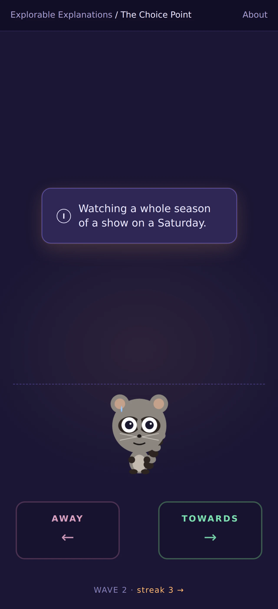
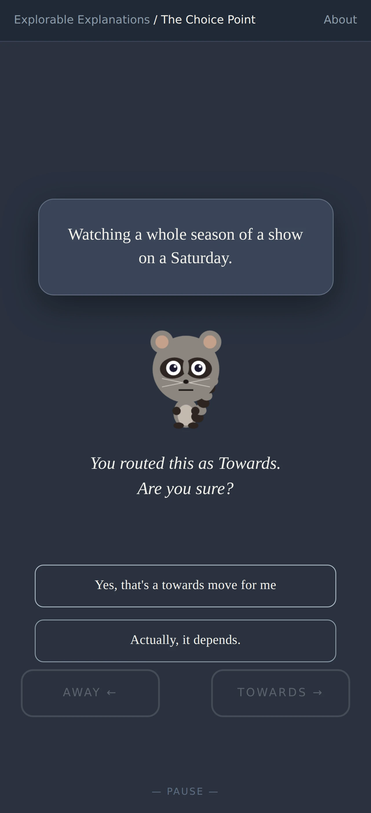
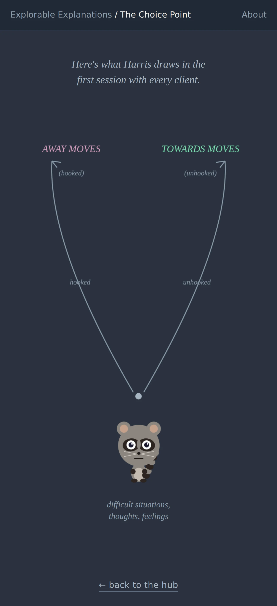

# The Catcher — Choice Point as Arcade

Design document for a new lesson in the activation-energy-game collection. Teaches ACT's Choice Point (Harris 2013) through a deliberately uneasy collision of reflex-speed classification and slow re-examination.

Source for concept citations: `/home/developer/blog/_d/act.md`. Line references use format `act.md:LINE`.

## Mockups

Static HTML mockups rendered at iPhone viewport (427×933, DPR 3) using the repo's actual `drawRaccoon` code. These are the three key moments of the lesson.

| Arcade phase | Reflection beat | Ending diagram |
|:---:|:---:|:---:|
|  |  |  |
| Raccoon at the decision line, stressed expression, tile falling from above, AWAY/TOWARDS bins below. Deep indigo arcade palette. | The freeze-frame moment. Desaturated slate palette, raccoon `neutral` beside the floating tile. Calm buttons, no time pressure. | Harris's Choice Point diagram drawn procedurally. Raccoon anchored at the "difficult situations" node at the bottom — he *is* the base of the diagram. |

---

## 1. Concept and framing

### The pitch

The raccoon stands at the bottom of the screen. Situations fall from above. The player taps left or right and the raccoon leans to catch each tile — sweeping it into the Away bin or the Towards bin. Speed rises. The raccoon's expression shifts with the player's routing rhythm — neutral at the start, stressed when the pace climbs, desperate when a pattern locks in. The twist: the game stops itself — mid-fall, freeze-frame — and the raccoon sits down beside the tile to ask *"you routed 'watching TV' as Towards. Are you sure?"* The collision between fast classification and slow re-examination is the lesson. The arcade isn't the teacher. The pauses are. The raccoon is the one living through it.

### The tonal risk, addressed

The risk is obvious: Tetris-ing mental-health scenarios could feel glib, or worse, mocking. The design doesn't avoid the arcade energy — it uses the arcade energy as the thing the lesson critiques. Four mechanisms handle this:

1. **The reflection beats are louder than the arcade.** When a pause fires, the whole canvas freezes, desaturates, and the falling tile floats upward instead of down. Music (if added) ducks to silence. The question is in full-screen typography, not a modal. The beat lasts as long as the player wants — no timer, no "tap to continue" countdown. The design rhythm is: frantic, *stop*, frantic, *stop*. The stops are the point.

2. **The voice is playful about the game, not about the content.** The framing narrator treats the *format* with some self-awareness — "yes, this is a Tetris-y thing about your psyche, bear with me" — while treating every scenario straight. Scenarios are never punchlines. The narrator's only jokes are at the format's expense.

3. **There is no score.** No "you got 73% of these right." No leaderboard, no grading. The arcade mechanic exists to manufacture the exact condition the lesson is about: classifying under pressure without thinking about function. Scoring would reward the thing the lesson is trying to undermine. (See §2 on why this matters.)

4. **The ending reclaims tone.** After the arcade ends, the player gets a quiet summary — *no arcade energy at all* — of the scenarios they saw, what their routings revealed about their default assumptions, and Harris's actual Choice Point diagram drawn in slow calm lines. The arcade was the hook. The ending is the lesson. This is where tonal repair happens. (See §6.)

### What this teaches

Primary teaching points — pick two, not all:

- **Workability, not form.** Harris's core move: ACT never asks "is this thought/activity good or bad?" It asks "does it take you toward the life you want?" (`act.md:116–126`, `act.md:432–436`). The arcade forces the player to classify by *form* because there's no time to ask about function. The reflection beats pry open function as a question.

- **Any activity can be a towards OR an away move, depending on function.** Harris's "watching TV to escape the gym vs. watching a show I love" (`act.md:107`, `act.md:416`). This is the insight the reflection beats are engineered around. A player who routes "scrolling Instagram" left on reflex gets asked: "what if it's how you unwind after a hard day?" A player who routes "going to the gym" right on reflex gets asked: "what if it's to punish yourself for eating?"

Secondary point that emerges naturally but isn't forced: **covert behavior counts** (`act.md:106`, `act.md:414`). Some falling tiles are internal — "ruminating about that email," "noticing a feeling of anger and allowing it." The player has to route these too. The very fact that you can *route* a thought is itself the covert-behavior insight.

Not trying to teach: defusion technique, acceptance, values clarification, the hexaflex. Those are other lessons. This one does the Choice Point and only the Choice Point.

---

## 2. Core loop

### The fall

- Situations appear at the top of the screen on a 3–5s drop cadence (speed scales with wave — see §5).
- Each situation is a **tile** — a rounded-rect card, ~280px wide on desktop, ~90% of viewport width on mobile, containing one short line of text. "Going to the gym you planned." "Scrolling for 45 minutes to avoid a task." "Texting your sister back."
- One tile is active at a time. Classic falling-piece discipline — no overlap, no stacking. This isn't Tetris mechanically, it's Tetris *aesthetically*. Each situation gets its own moment.
- The tile falls toward a horizontal **decision line** about 2/3 down the screen. Below the line: two bins, Away (left) and Towards (right).

### Routing

- **Touch/tap (mobile):** tap left half = Away, tap right half = Towards. Tap target is the whole screen half. No swipe — swipe is reserved for global navigation per CLAUDE.md page conventions.
- **Mouse (desktop):** click left or right half, or press ArrowLeft / ArrowRight.
- **Keyboard:** ArrowLeft / A = Away, ArrowRight / D = Towards. (Note this overrides the normal forward/back nav during arcade phase — see §7.)
- **The raccoon animates on every tap.** He leans in the direction of the routing, one paw out to catch the tile, and pushes it toward the bin. The lean tweens back to center in ~200ms ready for the next tile. This is the diegetic feedback — there's no particle effect, no point score, just the raccoon's body language doing the work.
- If the tile reaches the decision line unrouted, it drops straight down into a **third bin in the middle**: "Didn't choose." The raccoon visibly *misses it* — he doesn't react in time, or looks past it. This is not a failure — it's data. The ending summary notes how many were missed and frames it warmly ("sometimes we just react without choosing").

### The reflection beat — the twist

A reflection beat fires when *any* of these triggers hit:

- Player routes an **ambiguous tile** (flagged in the scenario data) — ~60% chance of firing.
- Player has routed **5 tiles in a row to the same side** — forces a pattern-break. ("You've sent five things to Away in a row. Let's look at the last one.")
- Player routes extremely fast (< 500ms) **three times in a row** — forces a slow-down. ("You're catching fast. Let's look at one slowly.")
- Every **7–10 tiles** regardless, as a floor.

When it fires:

1. The canvas freezes. All motion stops. The active tile — whichever was just routed — floats back to the center of the screen.
2. Everything else desaturates to ~30% opacity with a slight grayscale.
3. Background color shifts from the arcade palette (deep indigo / magenta) to a calm slate.
4. **The raccoon walks from the decision line to a spot beside the floating tile and sits down.** Expression changes from whatever the arcade had (stressed / desperate) to a thoughtful neutral — the posture is "let's look at this one together." He's not narrating, he's just present. The walk is 400ms, the sit is instant.
5. The tile is shown large in the center.
6. Typed text appears underneath: *"You routed this as Towards. Are you sure?"* — one of several variants (see §3). The question reads as coming *from* the raccoon, though there's no speech bubble — the raccoon and the text share a visual frame.
7. Two buttons appear, calmly styled (not arcade-colored): **"Yes, that's a towards move for me"** and **"Actually, it depends."**
8. If the player picks "Yes," the tile dissolves, the raccoon stands up and walks back to the decision line, the palette swaps back, and the arcade resumes. Their original routing stands.
9. If the player picks "Actually, it depends," a follow-up line appears: *"What would make it a towards move? What would make it an away move?"* — with two text-free illustrative micro-scenes (see §4). Then a calm button: **"Got it. Back to the catching."** The tile is marked *ambivalent* in the session log. Raccoon walks back.

Critically: **there is no "correct" answer at the reflection beat.** The game never says the player was wrong. It just asks them to look again. This is Harris's "the client defines what is an away move" (`act.md:108`, `act.md:415`) — the Choice Point is the player's worldview, not the designer's.

Duration: reflection beats are untimed. They last as long as the player wants. The only way out is by answering.

### Ratio

Roughly **1 reflection beat per 6–8 tiles routed**. Enough to keep the rhythm of stop-and-look. Not so many that the arcade tempo never establishes. The arcade tempo has to establish first, or the contrast won't land.

### Failure states

**There is no fail state.** The player cannot lose. There is no game over screen, no "you were hooked" penalty, no timer running out. The arcade format implies failure is possible — the design violates that expectation deliberately. That violation is part of the lesson: in the actual Choice Point, you never "lose" — you just notice, and route again next time.

The only thing that happens if you ignore tiles is they land in the "Didn't choose" bin, which the ending reflects back without judgment.

### Completing

The arcade ends after **a fixed number of tiles** — see §5 for count. When the last tile is routed, the canvas fades to the ending sequence (§6). The player can't replay the arcade from the end screen without restarting the lesson — the ending is where the meaning gets made, and "play again" would undermine it. (The game title in the header restarts the whole thing, per CLAUDE.md convention.)

---

## 3. Content: example scenarios

These scenarios ARE the curriculum. They matter more than any mechanic detail. The list below is a starting set of 22. The scenarios authored here draw from Harris's own examples (`act.md:107`, `act.md:145`, `act.md:172`) and from the practices list (`act.md:359–381`).

Format: `TEXT | default-classification | ambiguous? | notes`

### Obvious towards moves (should feel unambiguous)

1. **Going to the gym you planned the night before.** | towards | no |
2. **Texting your sister back about her birthday.** | towards | no |
3. **Opening the hard email and reading it.** | towards | no |
4. **Calling the doctor about the thing you've been ignoring.** | towards | no |
5. **Saying no to the meeting you shouldn't have been invited to.** | towards | no |
6. **Putting your phone in another room and reading a book.** | towards | no |

### Obvious away moves (should feel unambiguous)

7. **Scrolling for 45 minutes to avoid starting the report.** | away | no |
8. **Pouring a third drink because the day sucked.** | away | no |
9. **Canceling the plan at 6pm because you "don't feel like it."** | away | no |
10. **Re-reading the angry Slack message for the tenth time.** | away | no | rumination — covert
11. **Checking email at 11:47pm for the fourth time.** | away | no |
12. **Eating a whole sleeve of cookies standing up in the kitchen.** | away | no |

### Genuinely ambiguous — function, not form

13. **Watching a whole season of a show on a Saturday.** | --- | YES | escape OR chosen rest?
14. **Going for a long run.** | --- | YES | training OR anxiety-burn? (`act.md:172`)
15. **Making a to-do list for the project.** | --- | YES | planning OR stalling?
16. **Having a glass of wine with dinner.** | --- | YES | pleasure OR numbing?
17. **Reading about the news.** | --- | YES | civic engagement OR doomscrolling?
18. **Cleaning the entire kitchen instead of writing.** | --- | YES | care OR avoidance?
19. **Going to therapy.** | --- | YES | growth OR another thing to hide behind?
20. **Taking a long nap in the afternoon.** | --- | YES | rest OR depression hiding?
21. **Calling your mom.** | --- | YES | connection OR duty-driven guilt management?

### Covert behaviors (the "wait — is that even a move?" category)

22. **Noticing the anger and letting it be there.** | towards | yes (covert) | acceptance — towards. `act.md:215–220`
23. **Rehearsing tomorrow's argument for the twelfth time.** | away | yes (covert) | rumination / fusion with future
24. **Silently telling yourself "I'm not good enough."** | away | yes (covert) | fusion with self-concept `act.md:441–448`
25. **"I'm having the thought that I can't do this."** | towards | yes (covert) | defusion `act.md:361`

### Reflection beat question variants

The reflection beat picks one of these lines, parametrized with the tile text. Never more than two sentences. Always in second person. Never "correct / incorrect."

- "You routed '{X}' as Towards. Are you sure?"
- "You routed '{X}' as Away. Are you sure?"
- "Did '{X}' move you toward the life you want? Or away from something you didn't want to feel?"
- "That one went fast. '{X}' — take another look."
- "Five in a row to Away. Is that the pattern, or just reflex?"
- "'{X}' — was that you moving toward something, or you running from something?"
- "If a friend described '{X}' to you, would you call it a towards move for them? Does that change your answer?"
- "Any activity can be either. What matters is the function, not the form. What was the function of '{X}' for you?" (this one uses Harris's language directly — `act.md:107`)

### Follow-up on "Actually, it depends"

When the player taps that button, a second calm screen shows the same tile with two small illustrative captions side by side:

- **Towards if:** "...you chose it on purpose, with awareness of why."
- **Away if:** "...it was a way to not feel something."

Then the calm "Back to the catching" button. Total interruption: maybe 10 seconds if the player wants. Longer if they sit with it.

---

## 4. Visual design

### Layout — mobile (427 wide)

```
┌────────────────────────────────┐
│ Explorable Explanations / ...  │  48px standard header (CLAUDE.md)
├────────────────────────────────┤
│                                │
│          [ falling             │
│            tile ]              │
│                                │
│                                │  tile falls from here
│                                │
│                                │
│ - - - - - - - - - - - - - - -  │  decision line (dashed)
│             /\__/\             │
│            (  ^.^  )           │  raccoon anchored at
│             \  ~  /            │  decision line center
│   ┌────────┐      ┌────────┐   │
│   │  AWAY  │      │TOWARDS │   │
│   │   ←    │      │   →    │   │
│   └────────┘      └────────┘   │
│                                │
│  [thin streak counter: 3→]     │  minimal HUD
└────────────────────────────────┘
```

The raccoon is a persistent visual anchor. He stands on the decision line, between the two bins, roughly 80px tall on mobile / 110px on desktop. He is always on screen during the arcade phase. The player's taps drive his body language.

Touch targets: the entire left half and entire right half of the screen are taps zones. The bins are visual labels, not tiny buttons. Miss-taps are basically impossible.

### Layout — desktop

Same, but the canvas is 900×600 centered, with the bins further apart horizontally. The arrow-key hint shows next to each bin: `← A` and `D →`.

### Tile rendering

**Text tiles, not illustrations.** Each situation is a rounded rectangle, filled with a soft color, with one or two lines of text in a clean sans-serif. Small icon to the left of the text — a thin-line glyph that hints at category (phone icon, person icon, coffee cup, thought bubble for covert). The icons are drawn procedurally per CLAUDE.md (no sprites).

Why text tiles, not illustrations? Three reasons:

1. Illustrations would invite the player to route by visual cue — the lesson is exactly that this is *impossible* without knowing function. Text keeps the situation irreducible.
2. Procedural illustrations for 25+ scenarios would be a massive build for a lesson that teaches in 5 minutes. Not the right cost/value.
3. Text tiles look properly arcade-y when they fall. They have the Tetris energy the design needs.

### Feedback on routing

- **Ship to Away:** raccoon leans left, extends a paw, tile accelerates left along the paw's path, fades to muted gray-blue, and drops into the left bin with a soft *thunk*. Raccoon rocks back to center. Bin briefly pulses.
- **Ship to Towards:** raccoon leans right, extends a paw, tile accelerates right, brightens slightly (warmer color), drops into the right bin with a different soft *thunk*. Raccoon rocks back. Bin briefly pulses.
- **Critically: no green checkmark, no red X, no points.** The game does not tell you you were right or wrong. Because it can't — the game doesn't *know*. The raccoon treats every routing the same — no approval, no disapproval. He's the player's hand, not the judge.

### Reflection beat visual

Canvas takes over whole viewport. Animation sequence, ~400ms:

1. All motion halts in place.
2. Everything except the active tile desaturates to grayscale + 30% opacity.
3. Background color tweens from arcade-dark (indigo #1b1635) to calm-slate (#2a3240).
4. The active tile tweens upward to the visual center.
5. Typed text appears below the tile (typewriter, 40ms/char).
6. After the text finishes typing, two calm buttons fade in.

The buttons are deliberately un-arcadey: thin-line outlined rectangles, serif type, understated hover. The visual language of the reflection beats is the visual language of *reading*, not *playing*. The contrast is the message.

### Color and mood

Two palettes that the game toggles between:

**Arcade palette (falling phase):**
- Background: `#1b1635` deep indigo
- Tile fill: `#2e2854` warm violet with `#e8e4ff` text
- Away bin: `#4a3050` dim magenta border
- Towards bin: `#3a5a4e` dim teal border
- Accent: `#ffb86b` soft amber for the falling tile glow
- Font: clean geometric sans, maybe Inter or the existing game font

**Reflection palette (pause phase):**
- Background: `#2a3240` calm slate
- Tile fill: `#3a4558` with `#f0efe8` off-white text
- Button outlines: `#8a9aa8` muted steel
- Font: slightly softer — if available, a serif like Source Serif or the existing body text font

The palette swap is the loudest design signal that "we're not playing anymore."

### The raccoon — expression choreography

The raccoon is the throughline that ties this lesson to the rest of the repo. He is present in every phase — intro, arcade, reflection, ending — and his expression is the cheapest, most honest HUD the lesson has.

**Rendering:** the raccoon is drawn on his own dedicated `<canvas>` element positioned absolutely over the main lesson canvas, matching the pattern used in the energy lesson. This sidesteps the `clearRect` gotcha from CLAUDE.md — the raccoon's internal `clearRect` only wipes his own canvas, not the lesson's background with the bins and falling tiles. For the one moment where the raccoon needs to composite onto a shared canvas — the final gallery shot in the ending — use `drawRaccoonComposite` from `src/scenes/raccoonComposite.ts` with ear padding.

**Expression map** (from `src/characters/`):

| Phase / trigger                                 | Expression    | Why                                                    |
|-------------------------------------------------|---------------|--------------------------------------------------------|
| Intro card                                      | `neutral`     | He's not anxious yet. Just listening.                  |
| Wave 1 — normal rhythm                          | `neutral`     | Everything's fine. No pressure yet.                    |
| Wave 2 — pressure starts                        | `tired`       | The pace matters. He's working a little.               |
| Wave 3 — real pressure                          | `stressed`    | Classifying too fast to think.                         |
| 3 fast-routings (< 500ms) in a row              | `stressed`    | Triggers the reflection beat. Expression precedes it.  |
| 5-in-a-row same-side streak                     | `desperate`   | The pattern has locked in. Visible to the player.      |
| Reflection beat — sitting beside the tile       | `neutral`     | Calm. Thoughtful. The opposite of desperate.           |
| Reflection beat — "Actually, it depends"        | `neutral`     | Same calm. Unchanged by the player's answer.           |
| Ending — list screen                            | `tired`       | Something real just happened. He's spent.              |
| Ending — Harris diagram drawn                   | `neutral`     | Reading along with the player.                         |
| Ending — "the arcade cheated you" screen        | `neutral`     | Honest, not punitive.                                  |
| Ending — reconsider phase                       | `neutral`     | At rest, watching the player rework their routings.    |
| Ending — final takeaway question                | `happy`       | The only moment of warmth. Earned after the slowdown.  |

**Walking:** the raccoon uses `Character.walkTo` in two places only — walking from the decision line to beside the tile during a reflection beat, and walking across the ending sequence between the diagram and the reconsider list. Most of the time he's stationary and only his expression changes.

**The `desperate` moment matters.** When the streak-break reflection beat fires, the player must see the raccoon already looking desperate *before* the freeze-frame — the expression is what makes the pattern-break feel earned, not arbitrary. This is the subtlest choreography cue in the lesson and the one most likely to drift in implementation.

### Arcade energy on mobile

Mobile is the hard case. iPhone 17 Pro, 427×933, DPR 3. Three specific decisions:

- **Tile speed is tuned for 427px height, not desktop.** A tile traversing the full play area takes ~4s on wave 1, ~2s on wave 3. Below ~1.5s the scenario can't be read, so that's the floor.
- **Tap targets are half the screen.** No fiddly buttons. Your thumb lives in one of two zones.
- **The streak counter stays small** so the tile has air. HUD is one line at the bottom, 14px.
- **Reflection beats center vertically** with generous whitespace. On desktop they feel spacious; on mobile they feel like a real stop.

---

## 5. Pacing and length

### Target playtime

**4–6 minutes.** This is a short explorable, not a full lesson like /energy/. The reflection beats are the teaching, and five good ones is enough.

### Structure

- **Intro card** (30s): narrator frame, not arcade yet. "Harris — the ACT guy — draws this diagram in the first session with every client. Two arrows. Towards moves. Away moves. I'm going to show it to you at speed and then we'll talk. Tap to begin."
- **Wave 1** — 6 tiles, slow (~4s per tile), moderate mix of obvious + one ambiguous near the end. One reflection beat (the ambiguous one).
- **Wave 2** — 8 tiles, faster (~3s per tile), heavier on ambiguous + first covert tile. Two reflection beats.
- **Wave 3** — 8 tiles, faster still (~2s per tile), mostly ambiguous and covert. Two reflection beats, including the "five in a row" trigger if applicable.
- **Ending** — calm, untimed. (See §6.)

Total: ~22 tiles, ~4–5 reflection beats. Scenario pool has 25+, so every playthrough has some randomness, but the core teaching scenarios (e.g. #13 TV, #14 running, #22 noticing anger) appear in every run.

### Speed progression

Fall duration (seconds), tuned by hand and verified by playtest:

| Wave | Tiles | Seconds/tile | Notes |
|------|-------|--------------|-------|
| 1    | 6     | 4.0          | Establish the format |
| 2    | 8     | 3.0          | Pressure starts mattering |
| 3    | 8     | 2.0          | "You don't have time to think" — intentional |

Never faster than 2.0s — scenario text must be readable.

### When reflection beats fire

Recap of §2 triggers, with priorities:

1. **Priority 1:** 5-in-a-row streak → forced break. Fires immediately on the 5th.
2. **Priority 2:** 3 fast-routings (< 500ms) in a row → "take another look." Fires immediately on the 3rd.
3. **Priority 3:** ambiguous tile routed → fires ~60% of the time.
4. **Priority 4:** floor at every 8th tile if nothing else has fired.

At most one reflection beat per tile. No back-to-back beats.

---

## 6. The ending

This is where the design repays the tonal debt it took on with the arcade format. It must be slow, direct, and quiet.

### Sequence

1. **Last tile routes.** Arcade canvas fades to black over 800ms. Music (if any) stops. The raccoon's canvas stays on screen through the fade — he's what you keep looking at as the bins dissolve. His expression shifts to `tired`.
2. **Text appears beside the raccoon:** *"Okay. That was fast. Let's slow down."* — typewriter, then pause. The raccoon sits down.
3. **Second line:** *"Here's what you sent where."* — and a list appears: all 22 tiles, grouped by bin, small type, ungraded. No colors, no right/wrong marks, just the data. If the player marked any as "Actually, it depends," those appear in a middle column with a small icon indicating ambivalence. The raccoon sits beside the list, watching along.
4. **Third screen:** Harris's Choice Point diagram is drawn procedurally. The raccoon walks to beside the diagram as it draws. Slow lines — maybe 1.5 seconds for the diagram to draw itself. Bottom-center label: "difficult situations, thoughts, feelings." Two arrows out — left "Away moves (hooked)", right "Towards moves (unhooked)." The raccoon stands under the "difficult situations" label — he *is* the bottom of the diagram for a beat. Cite Harris: "Almost every psychological problem — anxiety, depression, addiction, any of them — reduces to the same loop: hooked by difficult thoughts and feelings, then away moves." (paraphrase, `act.md:102`)
5. **Fourth screen — the lesson.** The raccoon sits in the lower left. Two lines of text appear beside him:

   > "The arcade cheated you. It made you classify by the shape of the activity, not by its function. That's the one thing this diagnostic is trying to teach you NOT to do.
   >
   > Any activity can be a towards move or an away move. It's never the form. It's always the function." (`act.md:107`)

   The raccoon's expression stays `neutral` here — not apologetic, not smug. The honesty needs to land without being punitive.

6. **Fifth screen — the invitation.** The player sees their own list again, with one additional UI element per tile: a small "↻ reconsider" button. They can tap any tile to re-see it and change their routing, but this time there's no timer. The bins still don't tell them they're right. The game still doesn't know. But now they have as long as they want. The raccoon is off to the side, at rest, watching.

7. **Final screen — the takeaway.** Raccoon expression shifts to `happy` — the only moment of warmth in the whole lesson. One question, not a summary:

   > "What's one thing you routed just now that might be either, depending on the day?"

   There's a text field. Typing is optional. What they type is stored in localStorage and shown back to them if they return to this lesson later, as a small "last time you said..." note on the intro card. Nothing is sent anywhere. The raccoon waits.

8. **"Back to the hub"** link.

**The raccoon's arc across the ending:** tired → neutral → neutral → neutral → neutral → happy. One earned beat of warmth at the very end. Everything before it is restraint. This pacing matters — a happy raccoon anywhere earlier in the ending would cheapen the tonal repair.

### What the ending is doing

The ending is the design's entire answer to the tonal risk. The arcade was a setup — a *deliberate* setup — for a punchline that isn't a punchline. Harris's whole insight is that classification by *form* is the mistake the mind makes all day long. The arcade enacts that mistake. The ending names it.

This is why there's no score. This is why there's no fail state. This is why "play again" isn't offered at the end of the arcade phase — the arcade phase isn't something to win.

What the player is left with:

- A felt understanding that they *were* classifying by form under pressure, and they can feel how unreliable that was.
- One or two specific tiles they're less sure about now than they were when they routed them.
- Harris's actual diagram, drawn in calm lines, labeled in calm type.
- One question for themselves — workability (`act.md:116–126`) — that they can carry out of the browser tab.

---

## 7. Architecture notes

### Pattern choice: self-contained state machine

**Use the morning-choice pattern, not the Chapter/Scene framework.**

Rationale: the Catcher has one long phase (arcade) with a reflection-beat sub-state, then a ritual ending sequence. That's not 8 discrete chapters — it's one state machine with modes: `intro → wave1 → wave2 → wave3 → ending-list → ending-diagram → ending-lesson → ending-reconsider → ending-takeaway`. The reflection beats are a sub-state that pauses the wave, not a separate scene. The Chapter/Scene framework would fight this — it wants sequential autonomous scenes. The self-contained pattern in `src/lessons/morning-choice/game.ts` fits exactly.

Game class owns: canvas, state, current wave, tile queue, active tile, streak counter, fast-route timer, routing history, reflection-beat state, ending sub-screen state.

### New files

```
src/lessons/choice-point/
  index.html               # page entry point
  main.ts                  # bootstrap
  game.ts                  # the CatcherGame state machine (self-contained pattern)
  scenarios.ts             # the ~25 situations + reflection question variants
  tile.ts                  # tile creation, fall animation, routing animation
  reflection.ts            # reflection beat UI + animation sequence
  ending.ts                # the ending sequence — list render, diagram draw, reconsider state
  palette.ts               # arcade + reflection palettes + tween helper
```

No new top-level `src/interactions/` component — the tile and the reflection beat are too lesson-specific to reuse. Put them in `src/lessons/choice-point/`.

### Reusable components

From existing code:

- **`Character`** from `src/characters/` — **the raccoon is the main visual throughline of this lesson** (see §4 "The raccoon — expression choreography"). Uses all six expressions (`neutral`, `tired`, `stressed`, `desperate`, `happy`, `energized`) across the phases. `Character.setExpression(name)` is called on every wave transition, streak trigger, and ending beat. `Character.walkTo(x, y, duration)` is used for the reflection-beat walk and the ending diagram walk. Rendered on a dedicated absolutely-positioned `<canvas>` layered over the main lesson canvas — same pattern as the energy lesson — to avoid the `clearRect` gotcha from CLAUDE.md.
- **`drawRaccoonComposite`** from `src/scenes/raccoonComposite.ts` — used only in the final ending gallery moment where the raccoon needs to render onto a shared background canvas (the diagram screen and the takeaway screen). Ear padding matters here.
- **Tween.js** + the existing tween loop pattern (see `Game.ts`) — the tile fall, the palette swap, the diagram draw, the reflection-beat freeze, the raccoon lean-on-tap all use it.
- **`roundRect`** from `src/scenes/utils.ts` for tile drawing.
- **Typewriter** — morning-choice already has one on `mc-narrative`. Reuse pattern, don't copy-paste — if it's worth factoring, factor it.

### Not reusable

- Nothing from `src/sim/` applies — this lesson has no willpower model, no simulator, no fibers.
- Nothing from `src/interactions/` applies — those are all day-timeline / number-line / rope components specific to the energy lesson.
- The `WillpowerBar` is not shown on this page. This lesson doesn't use willpower as a mechanic.

### URL

**`/lessons/choice-point/`** — matches naming in CLAUDE.md's site structure. Add to `vite.config.ts` as a new `rollupOptions.input` entry.

### Page conventions checklist (from CLAUDE.md)

- [ ] Standard header with "Explorable Explanations / The Choice Point" breadcrumb
- [ ] About modal — describes ACT + Choice Point + links to Harris's book and to the act.md blog post
- [ ] Game title in header calls `game.restart()` — note: during arcade phase the ArrowLeft/ArrowRight keys are consumed for routing, but tap-to-restart works via the title
- [ ] Hub card added to `index.html` in the Lessons section, between morning-choice and free-evening
- [ ] Vite entry added
- [ ] Navigation: the page has two modes for keyboard input — during the arcade, ArrowLeft/Right route tiles (overrides forward/back nav intentionally). Intro card and ending screens use the normal ArrowLeft=back, ArrowRight=forward convention. The reflection beat has no arrow-key handling; the player must tap a button — this is deliberate slowness.
- [ ] Mobile-first — tested at 427×933, DPR 3 (Playwright)
- [ ] Screenshot both mobile and desktop per convention

### Data & state

Nothing server-side. Everything is ephemeral except the final takeaway text, which goes in `localStorage` under key `choice-point:last-reflection`.

---

## 8. Open questions

### Worth deciding before building

1. **Audio or silent?** This design presumes silent, because the repo's `sounds.ts` is still a stub and audio isn't load-bearing for the lesson. But the palette-swap-to-silence moment for reflection beats would be much louder *with* a low arcade-bed track that ducks. **Recommendation: silent v1, audio as a v2 pass.**

2. **Scenario tone — how specific?** Several tiles reference relationship items ("text your sister," "call your mom"). These feel more real but assume the player has a sister or a mom or has a complicated relationship with them. Alternative is to keep everything solo ("open the hard email"). **Recommendation: keep the relational ones — they're where the Choice Point earns its rent, and the specificity is what makes scenarios land. Player can route based on their own life, not mine.**

3. **Should reflection beats ever be retroactive?** "You routed the last 4 in a row as Away. Let's look at *all four* again." This is more powerful teaching but doubles the UI work. **Recommendation: no for v1. One tile at a time. The streak-based trigger already handles the pattern-break insight.**

4. **Does the covert-behavior category get its own wave?** Waves 1 and 2 are all-overt. Wave 3 introduces "noticing the anger" and "rehearsing the argument." Alternative: mix covert throughout. **Recommendation: hold covert for wave 3. The shock of realizing you can route a *thought* the same way you route an *action* is a meaningful beat.** Decision: punt to playtest. If covert-in-wave-3 feels jarring, redistribute.

5. **Does the ending "reconsider" phase let players actually change their routing?** Or is it read-only reflection? **Recommendation: let them change it. The reroute is the point — it demonstrates that with time and calm, you'd answer differently. That's the whole workability move.** But if the reroute creates a lot of edge-case UI (what does the bin list look like after reroutes?), it can be cut to read-only. Coin-flip call, picked one, noting here.

6. **Language and translation.** All scenarios are in US English with US cultural assumptions (gym, Slack, Instagram). Not designing for i18n in v1. **Recommendation: accept this, note in About modal.**

7. **Accessibility.** Screen-reader support for an arcade mechanic is genuinely hard. The reflection beats and ending are fully accessible (they're just text), but the falling-tile mechanic assumes vision + motor control. **Recommendation: ship with a "reader mode" toggle on the intro card that replaces the arcade with a sequential tile-by-tile classification with no time pressure — same scenarios, same reflection beats, same ending. This is a small amount of extra work and makes the lesson reach more people.** This might be the single most valuable addition to v1.

### Tradeoffs noted but not resolved

- **Arcade difficulty calibration.** Too easy and there's no pressure to classify-by-form. Too hard and players give up and route randomly, which defeats the lesson differently. Needs playtest to find the zone. Start at the table in §5 and adjust.
- **Number of reflection beats per run.** 4–5 is the plan. More feels naggy. Fewer and the lesson doesn't teach. Playtest decides.
- **"Didn't choose" bin framing.** Calling it "didn't choose" implies moral weight. Alternative names: "passed," "ran out," "floated past." **Recommendation: "didn't choose" — it's the most honest frame, and the ending reframes it kindly.**

### Scope knobs if build is too big

- Cut to 2 waves (12 tiles total) instead of 3 (22). Lesson still works. Saves maybe 30% of build.
- Cut the "reconsider" interactive phase from the ending. Keep it as a read-only list. Saves UI state for the rerouted bin.
- Cut covert-behavior tiles entirely. Loses the "you can route a thought" insight but keeps the core towards/away teaching.

### Scope knobs if build has more room

- Add a sound pass (arcade bed + reflection-beat silence).
- Add 10 more scenarios for replay variety.
- Add the "reader mode" accessibility toggle even if it wasn't prioritized.
- Track-and-show-back the player's routings across multiple visits via localStorage — "last time you routed 'going for a run' as Towards. Still?"

---

## Appendix: source cites

- `act.md:92–112` — The Choice Point concept, towards/away moves, hooked/unhooked
- `act.md:106`, `act.md:414` — Covert behavior definition, video-camera test
- `act.md:107`, `act.md:416` — Any activity can be either, function-not-form, watching-TV example
- `act.md:108`, `act.md:415` — Player/client defines their own away moves
- `act.md:116–126`, `act.md:432–436` — Workability as the core question
- `act.md:145`, `act.md:172` — DOTS and the "exercise as escape" example
- `act.md:359–381` — Practices list, including track towards/away weekly and the workability question
- `act.md:441–448` — Six categories of fusion (informs covert tile content)
